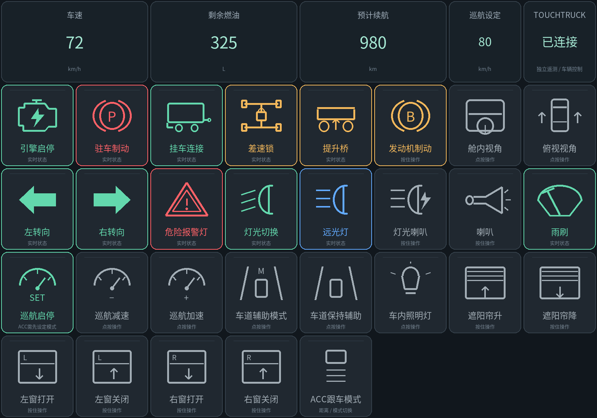

# ETS2TruckPanel

[简体中文](README.zh-CN.md) · [English manual](docs/MANUAL.en.md) · [中文说明书](docs/MANUAL.zh-CN.md)

A personal touch-screen truck control panel for **Euro Truck Simulator 2**, built for Touch Portal and an 11-inch iPad in landscape orientation.

Vehicle controls, live telemetry, an offline Python runtime, and a reversible Windows installer—without requiring Trucky or a Trucky subscription. Touch Portal and its plugin-capable Pro license are required separately.



*Illustration with simulated readings and illuminated indicators, not a live game screenshot. All public-release icons are original project artwork.*

## Download and install

Download **`ETS2TruckPanel-v0.1.0-windows-x64.zip`** from [Releases](https://github.com/ZikunWang-Ricardo/ETS2TruckPanel/releases/latest), rather than GitHub's automatic source-code ZIP.

1. Extract the entire package to a writable local folder.
2. Save and fully exit ETS2 and Touch Portal.
3. Double-click **`Setup.cmd`**. Select the game directory, user-data directory and profile when prompted.
4. Start Touch Portal, review and accept its own TouchTruck plugin trust prompt, and choose the **TouchTruck** page on your tablet.
5. Start the game and test controls while parked.

The package includes its Python environment. You do **not** need to install Python, pip, Trucky, or a Touch Portal installer from this project. The installer console is currently Chinese; the [English manual](docs/MANUAL.en.md) explains each prompt.

## Features

- Engine, parking brake, trailer coupling, differential lock, lift axle and engine brake.
- Turn signals, hazards, lighting, high beams, light horn, horn and wipers.
- Cruise activation/speed adjustment, ACC mode, lane-assistance mode and lane keeping.
- Cabin light, separate left/right window controls, driver's sunshade, interior and top-down cameras.
- Live speed, fuel, range and cruise-set speed; supported indicators follow real game telemetry.
- Dedicated right-Ctrl + right-Shift shortcuts, preserving normal keyboard/controller expressions.
- Per-file backups, failed-install rollback and **`Restore.cmd`**. Only one selected profile is changed.

## Save-data boundaries

Game-side writes are restricted to the telemetry DLL and the selected profile's **`controls.sii`**. The installer does not edit career saves, money, jobs, trucks, `game.sii`, or `profile.sii`. It preserves existing controller device/axis settings. Unknown conflicting shortcuts are rejected instead of overwritten.

Keep installation backups. Cloud-sync conflicts, power loss and disk failure remain outside the installer's guarantees. See the manuals before restoring a configuration modified after installation.

## Requirements and limitations

- Windows 10/11 **x64**, ETS2 x64, and a separately installed Touch Portal with plugin support.
- Initially developed against ETS2 **1.62.3.3**; older versions missing required actions are rejected. Other versions are not comprehensively tested.
- RenCloud telemetry **V.1.12.1 / memory revision 12**, bundled with its MIT notice; Python **3.13.12** embedded runtime.
- The game must be in the foreground to receive input. Hold actions have an eight-second lost-release limit.
- Sunshade support depends on the truck. Some auxiliary controls have no telemetry-backed on/off indication.
- TrackIR/Tobii settings are not changed automatically. If only interior looking fails, check head tracking first.
- This first release is not an exhaustive compatibility certification across controllers, mods or truck models.

## Build and test

On Windows with Python 3.12 (the downloader supplies a pinned, OFL-licensed Noto CJK build font):

```powershell
python -m pip install -r requirements-build.txt
python tools/download_dependencies.py
python tools/build_page.py
python tools/build_share.py
$env:TOUCHTRUCK_TCP_TESTS='1'
python -m unittest discover -s tests -v
```

Runtime code uses the standard library; Pillow is a **build-only** dependency. Dependencies are downloaded from pinned upstream release URLs and verified before packaging. Binaries and personal configuration files are excluded from Git. See [third-party notices](THIRD_PARTY_NOTICES.md).

## License

The repository's existing **GPL-3.0** license applies to project code and original artwork; see [LICENSE](LICENSE). Third-party SDK/runtime components retain their own licenses. The public package contains no Trucky icon pack or proprietary Touch Portal application.
