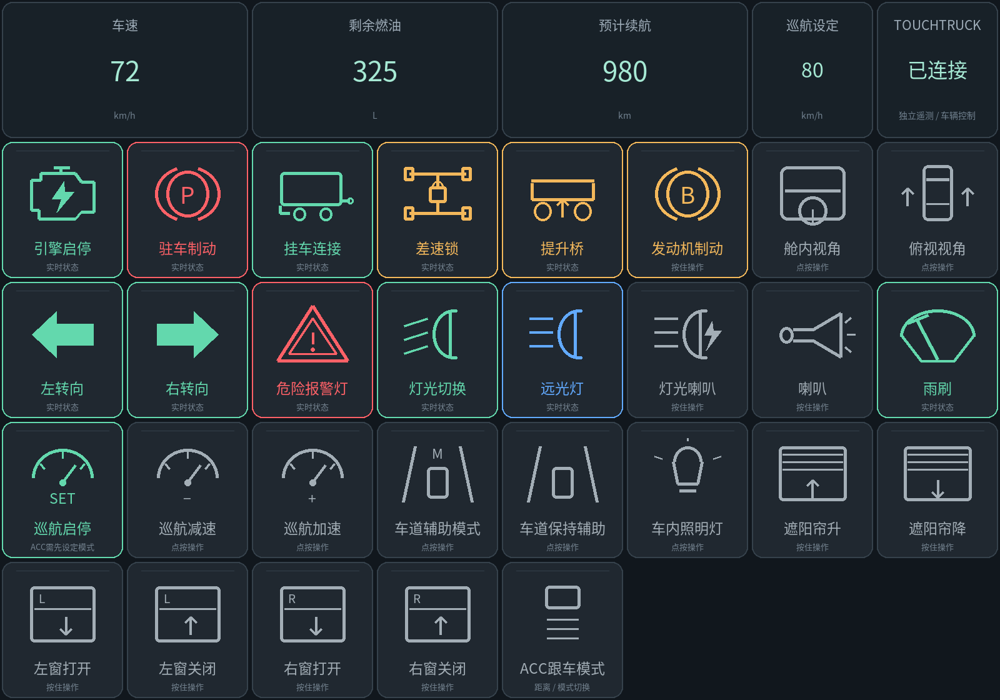

# ETS2TruckPanel

[English](README.md) · [中文说明书](docs/MANUAL.zh-CN.md) · [English manual](docs/MANUAL.en.md)

为《欧洲卡车模拟2》制作的触屏驾驶面板，适配 Touch Portal 和横屏 iPad Pro 11 英寸。

包含车辆控制、实时遥测、离线 Python 环境和可恢复的 Windows 安装器。**不需要 Trucky 或其订阅**；Touch Portal 主程序、手机 App 和支持插件的 Pro 授权需自行准备。

预览为模拟读数与指示灯点亮示意，并非实时游戏截图。公开版图标全部为本项目自行绘制。

## 安装

从 [Releases](https://github.com/ZikunWang-Ricardo/ETS2TruckPanel/releases/latest) 下载 **ETS2TruckPanel-v0.1.0-windows-x64.zip**，不要把 GitHub 自动生成的源码 ZIP 当成一键安装包。

1. 完整解压到可写文件夹。
2. 保存并完整退出 ETS2 和 Touch Portal。
3. 双击 **Setup.cmd**，选择游戏目录、用户资料目录和需要配置的档案。
4. 启动 Touch Portal，核对并确认 TouchTruck 插件的启动命令，在平板选择 TouchTruck 页面。
5. 启动游戏，在停车状态逐项测试。

无需另装 Python、pip；本项目不安装 Touch Portal 主程序。双击 Restore.cmd 可选择备份恢复。

## 功能

- 引擎、驻车制动、挂车连接分离、差速锁、提升桥、发动机制动。
- 左右转向、双闪、灯光、远光、灯光喇叭、喇叭、雨刷。
- 巡航启停与加减速、ACC 跟车模式、车道辅助模式、车道保持辅助。
- 车内照明灯、左右车窗分别开关、驾驶员遮阳帘、舱内和俯视视角。
- 车速、油量、续航和巡航设定速度；支持的图标状态与游戏遥测同步。

## 配置与存档保护

只写入游戏遥测 DLL 和所选档案的 **controls.sii**；不修改游戏进度、金钱、车辆、任务、game.sii 或 profile.sii。保留原有键盘、手柄表达式及设备、轴配置。

分享版为按钮增加右 Ctrl＋右 Shift 组合键，避免默认左 Ctrl 降挡冲突。先备份，安装中途失败会尝试回退；遇到来源不明的同类组合键会拒绝覆盖。只有一份选中的档案会被修改。

请保留 installation-backups。后续配置被修改时，恢复器会拒绝覆盖；断电、磁盘损坏、云同步冲突无法作绝对保证。

## 兼容性

- Windows 10/11 x64、ETS2 64位、Touch Portal Pro 插件支持。
- 初始开发环境为 ETS2 1.62.3.3；缺少所需动作的旧版本会被拒绝，其他版本尚未全面测试。
- 固定 RenCloud V.1.12.1 / revision 12，附 MIT 许可；Python 3.13.12 嵌入式环境。
- 按住操作最长8秒，可松开后再按；游戏需位于前台。
- 遮阳帘取决于车型；部分辅助功能没有真实遥测状态，不伪造亮灭反馈。
- 不自动修改 TrackIR/Tobii；若仅舱内右摇杆失效，应先检查头部追踪。

完整步骤、快捷键和故障处理见[中文说明书](docs/MANUAL.zh-CN.md)。源码构建步骤见 [English README](README.md#build-and-test)。

## 许可

沿用仓库原有的 [GPL-3.0](LICENSE)，适用于项目代码和自绘图标。第三方 SDK 与 Python 保留各自许可，见[第三方声明](THIRD_PARTY_NOTICES.md)。公开包不包含 Trucky 图标包或 Touch Portal 主程序。
